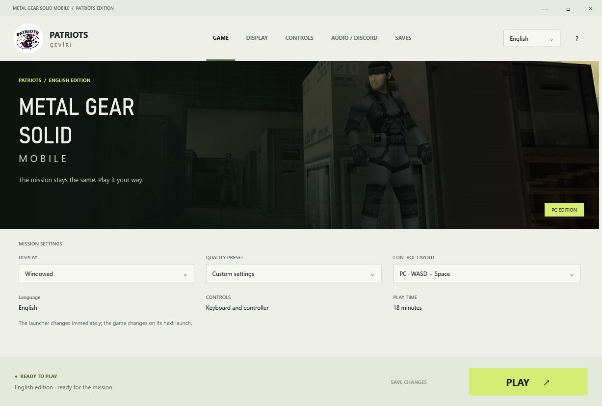
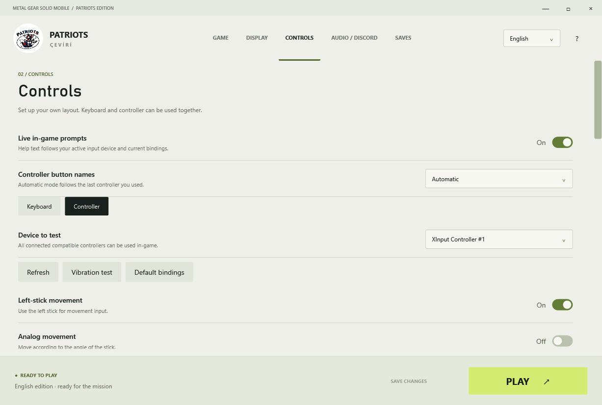
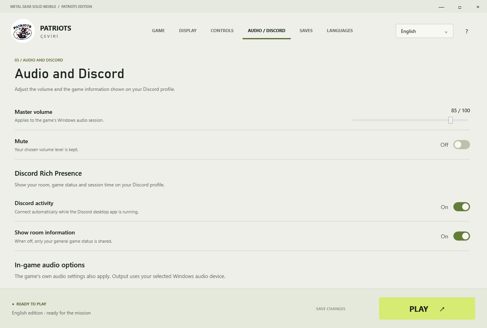
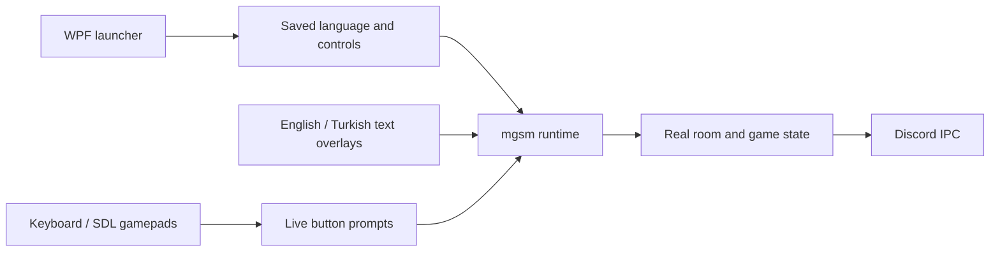

# Metal Gear Solid Mobile · Patriots Edition

A Windows PC experience with an English / Turkish launcher, importable community languages, dynamic input prompts and live Discord activity.

**[Türkçe](README.tr.md) · [Releases](../../releases) · [Add a language](docs/TRANSLATING.md) · [Build guide](docs/BUILD.md)**

## Android

**[Download Android APK](https://github.com/TheAti1/metal-gear-solid-mobile-patriots/releases/tag/android-v1.0.0) · [Android build / update guide](android-patriots/README.md)**

Android 9+, ARM64 / ARMv7 / x86_64; bundled game data, Turkish / English launcher and game, startup update checks and verified signed APK updates. Android releases use a separate channel from PC.

## Features

| Feature | English | Türkçe |
|---|:---:|:---:|
| Launcher, settings and messages | ✓ | ✓ |
| Game menus and dialogue | Original English | Patriots translation |
| Live keyboard / gamepad prompts | ✓ | ✓ |
| Xbox / PlayStation / Nintendo button names | ✓ | ✓ |
| Discord room, game status and session timer | ✓ | ✓ |
| Shared saves and automatic backups | ✓ | ✓ |

- Change language from the selector in the launcher header. The launcher changes immediately; the game uses the selection on its next launch.
- Import launcher/game JSONs separately or together as a language-pack ZIP from **LANGUAGES**. Partial packs use English for missing text, with live input prompts and Discord still enabled.
- Rebind keys and controller buttons while playing. The help text follows the current input device and bindings.
- Choose borderless fullscreen, widescreen camera framing, FOV, MSAA, render scale and texture filtering.
- **Crisp Interface** keeps bitmap text/HUD sampling sharp independently of 3D filtering. Keep Original Pixel Resolution **off** for high-resolution gameplay; it reduces the whole scene to phone resolution.
- Optionally invert vertical navigation **only in weapon/equipment menus** for keyboard, D-pad and left stick, including live updates.
- Show the current room, Codec conversations, cutscenes and pause state on Discord, with game art and the Patriots logo. Room sharing has its own switch.

## Getting started

1. Download the Windows package from **[Releases](../../releases)** and extract the complete folder.
2. Open **Metal Gear Solid Mobile.exe**.
3. Choose **English** or **Türkçe**, configure controls if needed, then press **PLAY / OYNA**.

Existing local saves are shared between languages. Distribution archives start with a clean save folder.
Discord integration uses the desktop client's local IPC connection and the configured application ID. Keep the Discord desktop app running to publish activity.

### Help translate

The **[translation guide](docs/TRANSLATING.md)** separates launcher text and game text, explains import/export, fonts and existing translated DAT conversion. Download the **Translation Kit** from [Releases](../../releases) for original tables and font references.

Brazilian Portuguese contributors can start with the **[299-entry launcher JSON](localization/launcher/pt-BR.launcher.json)** and **[game JSON](localization/game/pt-BR.game.json)**. Edit `text` fields and preserve placeholders. These are blank templates; Portuguese will become a bundled official language after the completed translation is reviewed.

### Default controls

| Action | Keyboard | Xbox |
|---|---|---|
| Move | WASD / arrow keys | Left stick / D-pad |
| Action / fire | Space / J | A / RT |
| First-person view | C | Y / LT |
| Codec / pause | Q / Tab | Start / X |
| Equipment / back | E / Esc | B / RB |
| Camera mode | R / Numpad * | LB |

All bindings are configurable in the launcher. **F1** opens the runtime settings and **F12** takes a screenshot.

## Screenshots

| Controller settings | Audio and Discord |
|---|---|
|  |  |

## How it works

The runtime executes the original ARM game code using **Unicorn**, with PC graphics, audio and input provided by **LeithSilver/mgsm**. Patriots adds a WPF launcher, locale overlays, runtime text hooks and room-aware Discord presence.

Game text overlays are read separately from shared game assets and saves. The source tree includes the launcher, modified runtime, translation source, font tools and reproducible build instructions. Prepared game data is supplied in the local package / release and stays outside Git history.

## Development

See **[docs/BUILD.md](docs/BUILD.md)** for Windows builds, dependencies and checks.

- `launcher/` — C# / WPF interface, embedded English catalogue, input configuration, saves and Discord IPC.
- `runtime/` — modified mgsm source, live prompts, locale-aware VFS and room tracking.
- `localization/launcher/` and `localization/game/` — separate, stable translation templates; the older completed Turkish catalogue remains available in `localization/`.
- `tools/` — archive and font tooling.
- `docs/` — build instructions, screenshots and validation.

## Credits and licensing

- **Konami / Kojima Productions / Ideaworks3D** — original game, 2008.
- **[LeithSilver/mgsm](https://github.com/LeithSilver/mgsm)** — runtime base, commit `4e6d91ceadfb898322f535f82f24a394197d892b`, GPL-2.0-or-later.
- **[Patriots Çeviri](https://www.patriotsceviri.com.tr/)** — Turkish localization, launcher and integration work.
- **Unicorn, SDL3, Dear ImGui, miniz, LZMA and LLVM-MinGW** — runtime and build dependencies.

The launcher and repository-level additions use **GPL-3.0-or-later**. The runtime retains its upstream notices and GPL-2.0-or-later license in `runtime/LICENSE`. Third-party notices remain with their respective components. Game data, artwork and trademarks retain their respective ownership.
