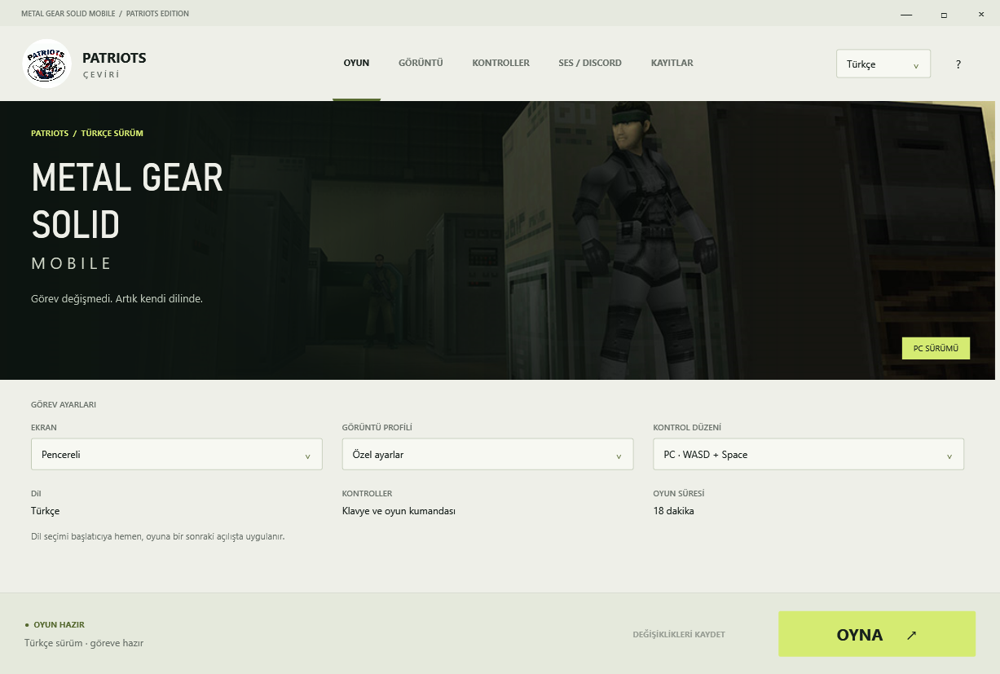

# Metal Gear Solid Mobile · Patriots Edition

**Türkçe / İngilizce / Brezilya Portekizcesi başlatıcı ve oyun · Yeni dil içe aktarma · Canlı tuş yazıları · Discord Rich Presence**

[English](README.md) · [Sürümler](../../releases) · [Yeni dil ekleme](docs/TRANSLATING.tr.md) · [Derleme rehberi](docs/BUILD.md)

## Android

**[Download Android APK](https://github.com/TheAti1/metal-gear-solid-mobile-patriots/releases/tag/android-v1.1.1) · [Android build / update guide](android-patriots/README.md)**

Android 9+, ARM64 / ARMv7 / x86_64; oyun dosyaları APK içinde, Türkçe / İngilizce / Portekizce seçimi ve açılışta güncelleme kontrolü. Android sürümleri PC sürümlerinden ayrı bir kanalda yayımlanır.

Android başlatıcısı PC tasarımıyla yenilendi: aynı görseller ve renkler, sabit OYNA düğmesi, telefon/tablete uyarlanan sekmeler. [Görseller ve kontroller](docs/ANDROID-LAYOUT.md).

## Neler var?

- Başlatıcının sağ üstünden **Türkçe / English / Português (Brasil)** seçimi. Arayüz hemen değişir; oyun seçilen dilde bir sonraki açılışta başlar.
- **DİLLER** sekmesinden launcher/oyun JSON'unu ayrı ayrı veya birlikte ZIP olarak içe aktarma, boş metinlerde İngilizceye dönüş ve çeviri şablonu dışa aktarma.
- Oyun içindeki tuş yazıları klavye veya kontrolcüye ve güncel atamalara göre değişir.
- Xbox, PlayStation ve Nintendo tuş adları; oyun açıkken tuş atamalarını değiştirme.
- Tam ekran, geniş ekran kamera, görüş alanı, kenar yumuşatma, çizim ölçeği ve doku seçenekleri.
- **Keskin arayüz** ile menü/yazı/HUD örneklemesi 3B dokulardan bağımsızdır. Yüksek çözünürlüklü oynanış için **özgün piksel çözünürlüğünü kapalı** tutun; bu mod tüm sahneyi telefon çözünürlüğüne indirir.
- Klavye, yön tuşları ve sol analog için **yalnızca silah/ekipman menüsünde yukarı-aşağı tersleme**; oyun açıkken de uygulanır.
- Discord'da gerçek oda, Codec / ara sahne / duraklatma durumu, oturum süresi ve görseller.
- Üç dilde ortak kayıtlar, otomatik kayıt yedekleri ve dosya doğrulama.

## Oynamak

1. [Sürümler](../../releases) bölümündeki Windows paketini indir ve klasörün tamamını çıkar.
2. **Metal Gear Solid Mobile.exe** dosyasını aç.
3. Dili seç, **OYNA / PLAY** düğmesine bas.

Discord desteği için masaüstü Discord uygulaması açık olmalıdır. **Ses / Discord** bölümünden etkinlik ve oda paylaşımı ayrı ayrı kapatılabilir.

| İşlev | Klavye | Xbox |
|---|---|---|
| Hareket | WASD / yön tuşları | Sol analog / yön tuşları |
| Eylem / ateş | Space / J | A / RT |
| Birinci şahıs | C | Y / LT |
| Codec / duraklatma | Q / Tab | Start / X |
| Ekipman / geri | E / Esc | B / RB |
| Kamera modu | R / Num * | LB |

Atamalar başlatıcıdan değiştirilebilir. **F1** motor ayarlarını, **F12** ekran görüntüsü işlevini açar.
Mevcut yerel kayıtlar üç dilde de kullanılabilir; dağıtım ZIP'i kişisel kayıt içermez.

## Çeviriye katkı

Brezilya Portekizcesi artık üçüncü resmî dil. **[(Sanju Vinho e Fumaça)](https://steamcommunity.com/id/SanjiVinsmokeBRASIL/)** tarafından çevrilen 299 başlatıcı metni ve 1.862 etkin oyun/motor metni PC ve Android paketlerine eklendi. [Portekizce kapsam ve derleme notları](docs/PORTUGUESE.md). Yeni bir dil için başlatıcıdan boş şablon dışa aktarın; `pt-BR.*.json` dosyaları tamamlanmış çeviridir.

[Çeviri rehberi](docs/TRANSLATING.tr.md) kurulum ve teslim sürecini anlatır. [Sürümlerdeki](../../releases) Translation Kit, oyun tablolarını ve font araçlarını da ayrı klasörlerde sunar. Mevcut çevrilmiş DAT dosyalarını JSON'a dönüştürme aracı da dâhildir.

## Proje yapısı

`launcher/`: WPF başlatıcı ve Discord bağlantısı. `runtime/`: değiştirilmiş mgsm motoru.
`localization/launcher/` ve `localization/game/`: ayrı çeviri şablonları. Önceki Türkçe JSON da korunur. `tools/`: arşiv, font ve çeviri dönüştürme araçları. `docs/`: derleme ve testler.

Altyapı, özgün ARM oyun kodunu Unicorn ile çalıştırır; PC grafik, ses ve girişini mgsm sağlar.
Kaynak kodundan derlemek için [derleme rehberini](docs/BUILD.md) kullan.

## Emeği geçenler

Özgün oyun: Konami / Kojima Productions / Ideaworks3D (2008).
Altyapı: [LeithSilver/mgsm](https://github.com/LeithSilver/mgsm), GPL-2.0-or-later.
Türkçe çeviri, başlatıcı ve entegrasyon: [Patriots Çeviri](https://www.patriotsceviri.com.tr/).
Başlatıcı ve depo ekleri GPL-3.0-or-later; bileşenlerin özgün lisansları korunmuştur.
